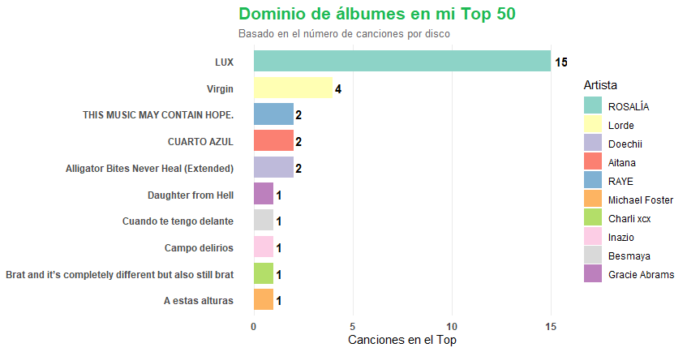

# Spotify Top Analysis (R)

Análisis de tus artistas, canciones y álbumes más escuchados usando la Spotify Web API, autenticación OAuth y visualización con `ggplot2`.

*Analysis of your most-listened artists, tracks, and albums using the Spotify Web API, OAuth authentication, and `ggplot2` visualization.*




---

## 🇪🇸 Español

### Qué hace este proyecto

Este script en R se conecta a la Spotify Web API para obtener tus datos de escucha personales y generar:

- Tu top de artistas y canciones (por rango de tiempo: 4 semanas, 6 meses o histórico)
- Un ranking de los álbumes que más se repiten en tu top 50 de canciones
- Una visualización con `ggplot2` del dominio de álbumes en tu top

### Cómo funciona

- **Autenticación:** OAuth 2.0 Authorization Code Flow, implementado con `httr2` (`oauth_client()` + `oauth_flow_auth_code()`). Se probó primero con el paquete `spotifyr`, pero se optó por una implementación manual con `httr2` por un conflicto entre `localhost` y `127.0.0.1` en la redirect URI.
- **Llamadas a la API:** una función reutilizable `get_top()` que evita repetir código para pedir artistas o canciones.
- **Procesamiento de datos:** `dplyr` para agrupar y transformar los resultados de la API en tablas legibles.
- **Visualización:** `ggplot2`, con una paleta inspirada en el verde de Spotify.

### Cómo ejecutarlo

1. Clona el repositorio:
   ```bash
   git clone https://github.com/tu-usuario/spotify-top-analysis.git
   ```
2. Instala las dependencias necesarias:
   ```r
   install.packages(c("httr2", "dplyr", "ggplot2", "httpuv"))
   ```
3. Crea una app en el [Spotify Developer Dashboard](https://developer.spotify.com/dashboard) y añade `http://127.0.0.1:1410/` como Redirect URI.
4. Copia `.Renviron.example` a `.Renviron` y rellena tus credenciales:
   ```
   SPOTIFY_CLIENT_ID=tu_client_id
   SPOTIFY_CLIENT_SECRET=tu_client_secret
   ```
5. Reinicia la sesión de R (`Session → Restart R`) para que se cargue el `.Renviron`.
6. Ejecuta `spotify_top_analysis.R`. Se abrirá el navegador para iniciar sesión en Spotify y autorizar la app.

## Análisis SQL en BigQuery

Las tablas generadas en R se exportaron a CSV y se cargaron en Google BigQuery para
analizar y validar los datos con SQL:

- Artistas con más canciones en el top, con su mejor puesto y su puesto medio
- Reparto del ranking por tramos (CASE)
- Canción mejor posicionada de cada artista (funciones de ventana: ROW_NUMBER)
- Validación cruzada entre el top 50 de canciones y el resumen por álbumes
  (FULL OUTER JOIN), señalando los registros que no cuadran

Consultas: [`bigquery/queries.sql`](bigquery/queries.sql)

### Conclusiones
- Las 50 canciones del top proceden de 30 álbumes distintos.
- *LUX* de ROSALÍA domina el ranking con 15 de las 50 canciones (30 %), seguido de
  *Virgin* de Lorde con 4.
- Validación cruzada: las 30 combinaciones álbum–artista coinciden entre el top 50
  de canciones y el resumen por álbumes, y cubren las 50 canciones.

### Notas

- Las credenciales nunca están hardcodeadas en el código; se cargan con `Sys.getenv()` desde un archivo `.Renviron` que está excluido del repositorio vía `.gitignore`.
- Los datos que devuelve la API son personales de cada usuario que autoriza la app — nadie más puede ver tus datos con este código.

---

## 🇬🇧 English

### What this project does

This R script connects to the Spotify Web API to retrieve your personal listening data and generate:

- Your top artists and tracks (by time range: last 4 weeks, 6 months, or all-time)
- A ranking of the albums that appear most often in your top 50 tracks
- A `ggplot2` visualization of album dominance in your top tracks

### How it works

- **Authentication:** OAuth 2.0 Authorization Code Flow, implemented with `httr2` (`oauth_client()` + `oauth_flow_auth_code()`). Initially attempted with the `spotifyr` package, but switched to a manual `httr2` implementation due to a `localhost` vs `127.0.0.1` redirect URI mismatch.
- **API calls:** a reusable `get_top()` function to avoid duplicating request logic for artists vs. tracks.
- **Data processing:** `dplyr` to group and reshape API responses into readable tables.
- **Visualization:** `ggplot2`, styled with a palette inspired by Spotify's green.

### How to run it

1. Clone the repository:
   ```bash
   git clone https://github.com/your-username/spotify-top-analysis.git
   ```
2. Install dependencies:
   ```r
   install.packages(c("httr2", "dplyr", "ggplot2", "httpuv"))
   ```
3. Create an app on the [Spotify Developer Dashboard](https://developer.spotify.com/dashboard) and add `http://127.0.0.1:1410/` as a Redirect URI.
4. Copy `.Renviron.example` to `.Renviron` and fill in your credentials:
   ```
   SPOTIFY_CLIENT_ID=your_client_id
   SPOTIFY_CLIENT_SECRET=your_client_secret
   ```
5. Restart your R session (`Session → Restart R`) so `.Renviron` gets loaded.
6. Run `spotify_top_analysis.R`. A browser window will open for you to log in to Spotify and authorize the app.

## SQL analysis in BigQuery

The R output tables were exported to CSV and loaded into Google BigQuery to analyse
and validate the data with SQL:

- Top artists by number of tracks, best and average position
- Distribution of the ranking by tiers (CASE)
- Best-ranked track per artist (window functions: ROW_NUMBER)
- Cross-table validation between the top 50 tracks and the album summary
  (FULL OUTER JOIN), flagging records that don't match

Queries: [`bigquery/queries.sql`](bigquery/queries.sql)

### Key findings
- The top 50 tracks come from 30 different albums.
- ROSALÍA's *LUX* dominates the ranking with 15 of the 50 tracks (30%), followed by
  Lorde's *Virgin* with 4.
- Cross-table validation: all 30 album–artist combinations matched between the
  top 50 track list and the album summary, accounting for all 50 tracks.

### Notes

- Credentials are never hardcoded; they're loaded via `Sys.getenv()` from a `.Renviron` file excluded from the repo via `.gitignore`.
- The data returned by the API is personal to whichever user authorizes the app — no one else's data is accessible through this code.

---

## Autora / Author

**Elena** — Ingeniera de energía en transición hacia Data Science, actualmente cursando el Máster en Big Data & Data Science (UNIR).
*Energy engineer transitioning into Data Science, currently pursuing a Master's in Big Data & Data Science (UNIR).*
